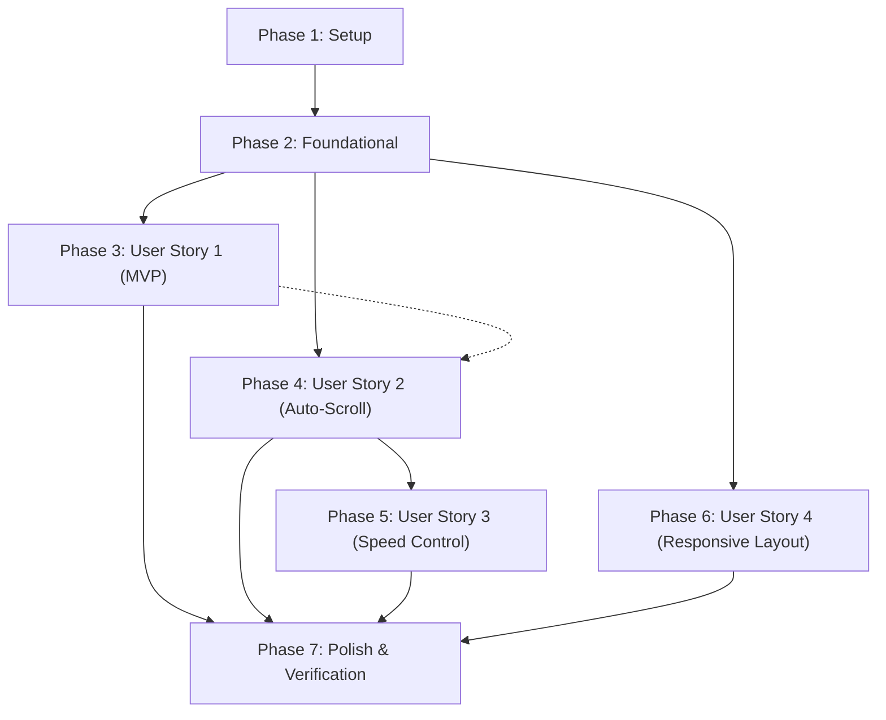

# Tasks: PDF Reader with Auto-Scroll and Speed Selector

**Input**: Design documents from `/specs/001-pdf-auto-scroll/`  
**Prerequisites**: `plan.md`, `spec.md`, `research.md`, `data-model.md`, `contracts/`, `quickstart.md`, `.specify/memory/constitution.md`  
**Tests**: TDD approach is mandatory per Constitution Principle III. Unit and component tests are included for each user story and must be executed before implementation code.  
**Organization**: Tasks are grouped by user story to enable independent implementation, testing, and MVP delivery.  

## Format: `[ID] [P?] [Story] Description`

- **[P]**: Can run in parallel (different files, no dependencies on incomplete tasks)
- **[Story]**: Which user story this task belongs to (`[US1]`, `[US2]`, `[US3]`, `[US4]`)
- Exact file paths are provided for all tasks

---

## Phase 1: Setup (Shared Infrastructure)

**Purpose**: Project initialization, Gradle dependencies, and Android application baseline.

- [X] T001 Initialize root and app Gradle build configuration with Kotlin 2.0, Jetpack Compose BOM, Lifecycle ViewModel, DataStore, and Coroutines in `build.gradle.kts`, `settings.gradle.kts`, and `app/build.gradle.kts`
- [X] T002 [P] Configure Android application manifest with Storage Access Framework (SAF) intent filters and window soft input settings in `app/src/main/AndroidManifest.xml`
- [X] T003 [P] Configure Compose Material 3 theme, dark/light color schemes, and reading typography in `app/src/main/java/com/madruga665/pdfreader/ui/theme/Theme.kt`, `app/src/main/java/com/madruga665/pdfreader/ui/theme/Color.kt`, and `app/src/main/java/com/madruga665/pdfreader/ui/theme/Type.kt`

---

## Phase 2: Foundational (Blocking Prerequisites)

**Purpose**: Core data models, persistence store, and common error handling required by all stories.

**⚠️ CRITICAL**: No user story work can begin until this phase is complete.

- [X] T004 [P] Create core document and session models `PdfDocument.kt` (constraints: `pageCount >= 1`, `fileSizeBytes >= 0`, `pageAspectRatios.size == pageCount`), `ReadingSession.kt` (constraints: `0.5 <= zoomScale <= 4.0`, `10.0 <= preferredSpeedPxPerSec <= 500.0`, `0.0 <= normalizedScrollRatio <= 1.0`), and `ReaderErrorState.kt` (sealed interface with `None`, `FileNotFound`, `PasswordRequired`, `CorruptedDocument`, `OutOfMemory`) in `app/src/main/java/com/madruga665/pdfreader/core/model/`
- [X] T005 [P] Create scroll models `ScrollConfiguration.kt` (constraints: `10.0 <= velocityPxPerSec <= 500.0`) and `SpeedPreset.kt` (enum values: `SLOW`=40f, `MEDIUM`=90f, `FAST`=180f, `CUSTOM`=-1f) in `app/src/main/java/com/madruga665/pdfreader/core/model/`
- [X] T006 [P] Implement `DataStoreReadingSessionStore.kt` per `ReadingSessionStore` contract to persist reading progress and user speed preferences asynchronously in `app/src/main/java/com/madruga665/pdfreader/core/storage/DataStoreReadingSessionStore.kt`
- [X] T007 Implement user-facing error dialog component `ErrorDialog.kt` supporting `ReaderErrorState` recovery actions in `app/src/main/java/com/madruga665/pdfreader/ui/components/ErrorDialog.kt`

**Checkpoint**: Core models and storage ready. User Story 1 implementation can now proceed.

---

## Phase 3: User Story 1 - Opening and Reading PDF Documents (Priority: P1) 🎯 MVP

**Goal**: Select and open a local PDF document, render pages in continuous vertical sequence with lazy virtualization, support pinch-to-zoom, and display page count.

**Independent Test**: Open a sample PDF from storage, verify Page 1 loads in <1.5s, scroll through pages with smooth lazy loading, zoom in/out, and verify corrupted file handling without app crash.

### Tests for User Story 1 ⚠️

- [X] T008 [P] [US1] Unit test `AndroidPdfDocumentRepositoryTest.kt` verifying PDF metadata parsing, page aspect ratio calculation, LRU bitmap caching, and error propagation in `app/src/test/java/com/madruga665/pdfreader/core/repository/AndroidPdfDocumentRepositoryTest.kt`
- [X] T009 [P] [US1] Unit test `ReaderViewModelTest.kt` verifying `ReaderIntent.OpenDocument`, loading states, page navigation, and error state emission in `app/src/test/java/com/madruga665/pdfreader/ui/reader/ReaderViewModelTest.kt`

### Implementation for User Story 1

- [X] T010 [US1] Implement `AndroidPdfDocumentRepository.kt` using `android.graphics.pdf.PdfRenderer` with background coroutine decoding and an `LruCache<Int, Bitmap>` for hardware bitmap recycling in `app/src/main/java/com/madruga665/pdfreader/core/repository/AndroidPdfDocumentRepository.kt`
- [X] T011 [P] [US1] Implement single page canvas component `PdfPageItem.kt` with placeholder rendering, aspect ratio preservation, and bitmap recycling in `app/src/main/java/com/madruga665/pdfreader/ui/components/PdfPageItem.kt`
- [X] T012 [US1] Implement virtualized document viewport `PdfDocumentViewport.kt` using Compose `LazyColumn` with continuous vertical layout, scroll state tracking, and pinch-to-zoom gesture scaling in `app/src/main/java/com/madruga665/pdfreader/ui/components/PdfDocumentViewport.kt`
- [X] T013 [US1] Implement baseline `ReaderViewModel.kt` handling `ReaderIntent.OpenDocument`, `PageChanged`, `SetZoomScale`, and session restoration in `app/src/main/java/com/madruga665/pdfreader/ui/reader/ReaderViewModel.kt`
- [X] T014 [US1] Implement `MainActivity.kt` with Storage Access Framework (SAF) document picker launcher and reader screen hosting in `app/src/main/java/com/madruga665/pdfreader/MainActivity.kt`

**Checkpoint**: User Story 1 is fully functional and delivers an independently testable MVP PDF reader.

---

## Phase 4: User Story 2 - Hands-Free Reading with Auto-Scroll (Priority: P1)

**Goal**: Continuous, steady downward scrolling at 60fps driven by delta-time math, with single-tap pause, drag-gesture interruption, and end-of-document halting.

**Independent Test**: Open a multi-page PDF, press Play on the auto-scroll pill, observe steady downward scrolling across page boundaries, single-tap to pause immediately (<50ms), and reach the final page to verify auto-halt.

### Tests for User Story 2 ⚠️

- [X] T015 [P] [US2] Unit test `AutoScrollEngineTest.kt` verifying delta-time accumulation consistency across 60Hz/120Hz refresh rates, play/pause toggling, and end-of-document boundary clamp in `app/src/test/java/com/madruga665/pdfreader/core/engine/AutoScrollEngineTest.kt`
- [X] T016 [P] [US2] Unit test auto-scroll intents (`ToggleAutoScroll`, `PauseAutoScroll`, `ResumeAutoScroll`) and touch interrupt handling in `app/src/test/java/com/madruga665/pdfreader/ui/reader/ReaderViewModelTest.kt`

### Implementation for User Story 2

- [X] T017 [US2] Implement headless delta-time scroll engine `DefaultAutoScrollEngine.kt` implementing `AutoScrollEngine` contract in `app/src/main/java/com/madruga665/pdfreader/core/engine/DefaultAutoScrollEngine.kt`
- [X] T018 [US2] Integrate `AutoScrollEngine` into `ReaderViewModel.kt` with `withFrameNanos` frame clock loop, auto-hide overlay timer (2s inactivity), and end-of-document completion detection in `app/src/main/java/com/madruga665/pdfreader/ui/reader/ReaderViewModel.kt`
- [X] T019 [P] [US2] Implement floating control overlay `FloatingAutoScrollOverlay.kt` with play/pause toggle button and fade-out animation in `app/src/main/java/com/madruga665/pdfreader/ui/components/FloatingAutoScrollOverlay.kt`
- [X] T020 [US2] Wire pointer touch and drag gesture interceptors in `PdfDocumentViewport.kt` to trigger instantaneous auto-scroll pause without coordinate drift in `app/src/main/java/com/madruga665/pdfreader/ui/components/PdfDocumentViewport.kt`

**Checkpoint**: User Stories 1 and 2 work seamlessly together, providing a fully hands-free PDF reading experience.

---

## Phase 5: User Story 3 - Dynamic Reading Speed Control (Priority: P2)

**Goal**: Intuitive speed selector with fine-grained slider ($10 \text{ px/s} \le \text{velocity} \le 500 \text{ px/s}$), step buttons, and instant presets (Slow: 40 px/s, Medium: 90 px/s, Fast: 180 px/s) updating in <16ms without scroll stutter.

**Independent Test**: Adjust speed during active auto-scroll via slider and presets, verifying instantaneous velocity changes without frame hitching, and verify speed settings persist across restarts.

### Tests for User Story 3 ⚠️

- [X] T021 [P] [US3] Unit test speed clamping ($10.0 \dots 500.0 \text{ px/s}$), step increments, and preset selection in `app/src/test/java/com/madruga665/pdfreader/core/engine/AutoScrollEngineTest.kt`
- [X] T022 [P] [US3] Unit test speed persistence and state flow updates in `app/src/test/java/com/madruga665/pdfreader/ui/reader/ReaderViewModelTest.kt`

### Implementation for User Story 3

- [X] T023 [P] [US3] Implement `SpeedSelectorControl.kt` featuring velocity slider, +/- step buttons, and preset chips (`Slow`, `Medium`, `Fast`) in `app/src/main/java/com/madruga665/pdfreader/ui/components/SpeedSelectorControl.kt`
- [X] T024 [US3] Integrate `SpeedSelectorControl.kt` into `FloatingAutoScrollOverlay.kt` connecting UI actions to `ReaderIntent.SetSpeed` and `ReaderIntent.SelectPreset` in `app/src/main/java/com/madruga665/pdfreader/ui/components/FloatingAutoScrollOverlay.kt`
- [X] T025 [US3] Connect speed updates to `DataStoreReadingSessionStore.kt` in `ReaderViewModel.kt` to persist the user's preferred velocity in `app/src/main/java/com/madruga665/pdfreader/ui/reader/ReaderViewModel.kt`

**Checkpoint**: User Story 3 complete. Readers have complete control over their reading cadence with persistence.

---

## Phase 6: User Story 4 - Responsive Experience across Phones and Tablets (Priority: P2)

**Goal**: Dynamic layout adaptation for smartphones, foldables, and tablets using Material 3 `WindowWidthSizeClass`, maintaining reading position within 10 vertical pixels across orientation rotations.

**Independent Test**: Test on phone and tablet emulators in portrait and landscape orientations; verify bottom pill on phones, side rail on tablets, and seamless scroll position retention across rotations.

### Tests for User Story 4 ⚠️

- [X] T026 [P] [US4] Unit test normalized scroll ratio calculation and position restoration across orientation change in `app/src/test/java/com/madruga665/pdfreader/ui/reader/ReaderViewModelTest.kt`

### Implementation for User Story 4

- [X] T027 [P] [US4] Implement adaptive scaffold `AdaptiveReaderScaffold.kt` switching between bottom bar (Compact) and side navigation rail (Expanded) based on `WindowWidthSizeClass` in `app/src/main/java/com/madruga665/pdfreader/ui/components/AdaptiveReaderScaffold.kt`
- [X] T028 [US4] Implement normalized scroll offset preservation in `ReaderViewModel.kt` across orientation changes in `app/src/main/java/com/madruga665/pdfreader/ui/reader/ReaderViewModel.kt`
- [X] T029 [US4] Integrate hardware keyboard shortcuts (Space bar for play/pause, +/- keys for speed adjustment) in `MainActivity.kt` and `AdaptiveReaderScaffold.kt` in `app/src/main/java/com/madruga665/pdfreader/MainActivity.kt`

**Checkpoint**: All user stories functional across all form factors and input modalities.

---

## Phase 7: Polish & Cross-Cutting Concerns

**Purpose**: End-to-end integration verification, automated UI testing, and security hardening.

- [X] T030 [P] Implement instrumented Compose UI test `ReaderScreenTest.kt` verifying document open, auto-scroll toggle, and speed adjustment in `app/src/androidTest/java/com/madruga665/pdfreader/ui/ReaderScreenTest.kt`
- [X] T031 [P] Verify edge case tests for encrypted, 0-byte, and malformed PDF files in `app/src/test/java/com/madruga665/pdfreader/core/repository/AndroidPdfDocumentRepositoryTest.kt`
- [X] T032 Execute quickstart verification scenarios from `specs/001-pdf-auto-scroll/quickstart.md` on device/emulator to validate 60fps performance and latency targets

---

## Dependencies & Execution Order

### Phase Dependencies



### User Story Dependencies

- **User Story 1 (P1 - MVP)**: Can start immediately after Phase 2 (Foundational). Has no dependencies on other stories.
- **User Story 2 (P1)**: Depends on Phase 2 (Foundational) and integrates with the viewport from US1. Can be tested independently using mock viewports.
- **User Story 3 (P2)**: Extends User Story 2's auto-scroll controls with speed customization and persistence.
- **User Story 4 (P2)**: Wraps the viewport and controls with adaptive scaffolding; can be developed in parallel once foundational models are ready.

### Parallel Opportunities

- **Phase 1 Setup**: `T002` and `T003` can run in parallel.
- **Phase 2 Foundational**: `T004`, `T005`, and `T006` can run in parallel.
- **Phase 3 US1**: Test tasks `T008` and `T009` can run in parallel before implementation; `T010` and `T011` can run in parallel.
- **Phase 4 US2**: Tests `T015` and `T016` can run in parallel; overlay `T019` can run in parallel with engine `T017`.
- **Phase 5 US3**: Tests `T021` and `T022` can run in parallel; UI `T023` can run in parallel.
- **Phase 6 US4**: Scaffold `T027` can run in parallel with test `T026`.

---

## Parallel Example: User Story 2

```bash
# Launch test tasks for User Story 2 simultaneously:
Task: "Unit test AutoScrollEngineTest.kt in app/src/test/java/com/madruga665/pdfreader/core/engine/AutoScrollEngineTest.kt"
Task: "Unit test auto-scroll intents in app/src/test/java/com/madruga665/pdfreader/ui/reader/ReaderViewModelTest.kt"

# Launch decoupled implementation components simultaneously:
Task: "Implement DefaultAutoScrollEngine.kt in app/src/main/java/com/madruga665/pdfreader/core/engine/DefaultAutoScrollEngine.kt"
Task: "Implement FloatingAutoScrollOverlay.kt in app/src/main/java/com/madruga665/pdfreader/ui/components/FloatingAutoScrollOverlay.kt"
```

---

## Implementation Strategy

### MVP First (User Story 1 Only)

1. Complete **Phase 1: Setup** (`T001` - `T003`)
2. Complete **Phase 2: Foundational** (`T004` - `T007`)
3. Complete **Phase 3: User Story 1** (`T008` - `T014`)
4. **STOP and VALIDATE**: Verify manual opening, rendering, and pinch-to-zoom on an Android device or emulator. Deliverable MVP!

### Incremental Delivery

1. Foundation + US1 $\to$ Functional basic PDF reader (MVP).
2. Add US2 $\to$ Hands-free auto-scroll with play/pause and touch interrupt.
3. Add US3 $\to$ Real-time speed adjustment with presets (Slow, Medium, Fast) and persistence.
4. Add US4 $\to$ Tablet side rail, foldables adaptation, and keyboard shortcuts.
5. Polish & Verification $\to$ Automated instrumentation tests and final release readiness.
