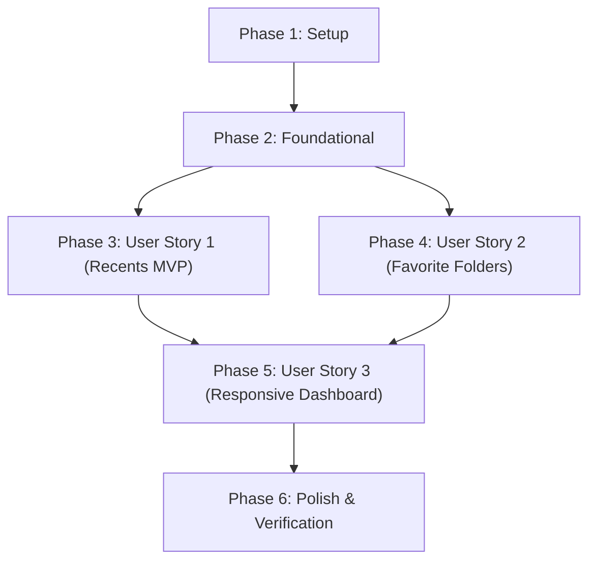

# Tasks: Home Screen Recents and Favorite Folders

**Input**: Design documents from `/specs/002-home-recents-favorites/`  
**Prerequisites**: `plan.md`, `spec.md`, `research.md`, `data-model.md`, `contracts/home-contracts.md`, `quickstart.md`, `.specify/memory/constitution.md`  
**Tests**: TDD approach is mandatory per Constitution Principle III. Unit tests for repositories and ViewModel must be implemented and executed before implementation code.  
**Organization**: Tasks are grouped by user story to enable independent implementation, testing, and MVP delivery.  

## Format: `[ID] [P?] [Story] Description`

- **[P]**: Can run in parallel (different files, no dependencies on incomplete tasks)
- **[Story]**: Which user story this task belongs to (`[US1]`, `[US2]`, `[US3]`)
- Exact file paths are provided for all tasks

---

## Phase 1: Setup (Shared Infrastructure)

**Purpose**: Dependency configuration and top-level navigation baseline.

- [X] T001 [P] Add `androidx.documentfile:documentfile` dependency to version catalog and app build file in `gradle/libs.versions.toml` and `app/build.gradle.kts`
- [X] T002 [P] Create top-level navigation screen model `AppScreen.kt` (sealed interface with `Home` and `Reader(val uri: Uri)`) in `app/src/main/java/com/madruga665/pdfreader/ui/navigation/AppScreen.kt`

---

## Phase 2: Foundational (Blocking Prerequisites)

**Purpose**: Core domain entities, repository contracts, and shared empty state components required by all user stories.

**⚠️ CRITICAL**: No user story work can begin until this phase is complete.

- [X] T003 [P] Create core entities `RecentDocument.kt` (constraints: `pageCount >= 1`, `0 <= lastReadPageIndex < pageCount`, `0.0 <= progressRatio <= 1.0`, `lastAccessedTimestamp != 0L`), `FavoriteFolder.kt` (constraints: `treeUri.isNotBlank()`, `displayName.isNotBlank()`, `pinnedTimestamp != 0L`, `cachedFileCount >= 0`), and `FolderPdfItem.kt` (constraints: `uri.isNotBlank()`, `fileName.isNotBlank()`, `fileSizeBytes >= 0L`, `lastModified >= 0L`) in `app/src/main/java/com/madruga665/pdfreader/core/model/`
- [X] T004 [P] Define repository interfaces `RecentsRepository.kt` and `FavoriteFoldersRepository.kt` per contract in `app/src/main/java/com/madruga665/pdfreader/core/home/RecentsRepository.kt` and `app/src/main/java/com/madruga665/pdfreader/core/home/FavoriteFoldersRepository.kt`
- [X] T005 [P] Implement shared empty state component `HomeEmptyState.kt` with primary actions to open a document or pin a folder in `app/src/main/java/com/madruga665/pdfreader/ui/components/HomeEmptyState.kt`

**Checkpoint**: Core models and contracts ready. User Story 1 implementation can now proceed.

---

## Phase 3: User Story 1 - Quick Resume from Recent Documents (Priority: P1) 🎯 MVP

**Goal**: Record every opened document with reading progress (page, progress ratio, timestamp), display chronologically ordered recent cards on Home screen, allow resuming with 1 tap, and allow removing items.

**Independent Test**: Open a PDF, scroll to page 2, go back to home, verify recent card displays `Page 2 of N` and progress percentage, tap to resume directly at page 2, and test item removal.

### Tests for User Story 1 ⚠️

- [X] T006 [P] [US1] Unit test `DataStoreRecentsRepositoryTest.kt` verifying de-duplication, sorting by most recent first, max 30-item cap enforcement, and item removal in `app/src/test/java/com/madruga665/pdfreader/core/home/DataStoreRecentsRepositoryTest.kt`
- [X] T007 [P] [US1] Unit test `HomeViewModelTest.kt` verifying loading recents, `HomeIntent.OpenDocument`, and `HomeIntent.RemoveRecent` in `app/src/test/java/com/madruga665/pdfreader/ui/home/HomeViewModelTest.kt`

### Implementation for User Story 1

- [X] T008 [US1] Implement `DataStoreRecentsRepository.kt` using DataStore Preferences JSON serialization enforcing 30-item cap in `app/src/main/java/com/madruga665/pdfreader/core/home/DataStoreRecentsRepository.kt`
- [X] T009 [P] [US1] Implement `RecentDocumentCard.kt` displaying title, page progress, timestamp, and a contextual action menu (Remove from Recents) in `app/src/main/java/com/madruga665/pdfreader/ui/components/RecentDocumentCard.kt`
- [X] T010 [US1] Implement MVI contracts and baseline ViewModel `HomeViewModel.kt`, `HomeViewState.kt`, `HomeIntent.kt`, and `HomeSideEffect.kt` in `app/src/main/java/com/madruga665/pdfreader/ui/home/`
- [X] T011 [US1] Hook document access recording into `ReaderViewModel.kt` to update `RecentsRepository` whenever a document is opened or progress saved in `app/src/main/java/com/madruga665/pdfreader/ui/reader/ReaderViewModel.kt`

**Checkpoint**: User Story 1 is functional and testable independently as an MVP recent documents dashboard.

---

## Phase 4: User Story 2 - Pinning and Browsing Favorite Folders (Priority: P2)

**Goal**: Pin directories from device storage using SAF `OpenDocumentTree`, list favorite folders on Home, browse PDFs within a pinned folder, open files directly, and unpin folders.

**Independent Test**: Pin a folder containing PDFs, verify folder card with file count appears on Home, tap folder to view PDF list dialog/screen, tap a PDF to read, and unpin folder without deleting disk files.

### Tests for User Story 2 ⚠️

- [X] T012 [P] [US2] Unit test `AndroidFavoriteFoldersRepositoryTest.kt` verifying folder tree URI persistence, PDF scanning, file count caching, and unpinning in `app/src/test/java/com/madruga665/pdfreader/core/home/AndroidFavoriteFoldersRepositoryTest.kt`

### Implementation for User Story 2

- [X] T013 [US2] Implement `AndroidFavoriteFoldersRepository.kt` using `DocumentFile` and DataStore Preferences to store pinned folder bookmarks in `app/src/main/java/com/madruga665/pdfreader/core/home/AndroidFavoriteFoldersRepository.kt`
- [X] T014 [P] [US2] Implement `FavoriteFolderCard.kt` displaying folder display name, path summary, and PDF count chip in `app/src/main/java/com/madruga665/pdfreader/ui/components/FavoriteFolderCard.kt`
- [X] T015 [P] [US2] Implement `FolderContentsDialog.kt` to display a list of all PDFs inside a selected folder with item click and unpin actions in `app/src/main/java/com/madruga665/pdfreader/ui/components/FolderContentsDialog.kt`
- [X] T016 [US2] Integrate folder management (`AddFolder`, `RemoveFolder`, `SelectFolder`, `OpenPdfFromFolder`) into `HomeViewModel.kt` in `app/src/main/java/com/madruga665/pdfreader/ui/home/HomeViewModel.kt`

**Checkpoint**: User Stories 1 and 2 operate seamlessly together on the Home dashboard.

---

## Phase 5: User Story 3 - Responsive Home Dashboard across Phones and Tablets (Priority: P2)

**Goal**: Fluid home screen layout adapting across compact phones (stacked flow with horizontal recents carousel) and expanded tablets (multi-column dashboard grid), with seamless back navigation.

**Independent Test**: Run on phone and tablet in portrait and landscape; verify proper section layout, touch ergonomics, and back navigation between Reader and Home.

### Implementation for User Story 3

- [X] T017 [P] [US3] Implement `HomeScreen.kt` with adaptive layout for `WindowWidthSizeClass` (Compact carousel vs Expanded multi-column grid) in `app/src/main/java/com/madruga665/pdfreader/ui/home/HomeScreen.kt`
- [X] T018 [US3] Update `MainActivity.kt` with `ActivityResultContracts.OpenDocumentTree()` launcher and top-level screen switching between `HomeScreen` and `AdaptiveReaderScaffold` with system back handling in `app/src/main/java/com/madruga665/pdfreader/MainActivity.kt`

**Checkpoint**: Full responsive dashboard complete across all form factors.

---

## Phase 6: Polish & Cross-Cutting Concerns

**Purpose**: Stale file/folder error tolerance, automated test passes, and end-to-end verification.

- [X] T019 [P] Verify edge-case handling for deleted or inaccessible files/folders with user-facing alerts in `app/src/test/java/com/madruga665/pdfreader/core/home/DataStoreRecentsRepositoryTest.kt`
- [X] T020 Execute quickstart verification scenarios from `specs/002-home-recents-favorites/quickstart.md`, compile APK with `./gradlew assembleDebug`, and verify test suite pass

---

## Dependencies & Execution Order

### Phase Dependencies



### User Story Dependencies

- **User Story 1 (P1 - MVP)**: Can start immediately after Phase 2 (Foundational). Has no dependencies on User Story 2.
- **User Story 2 (P2)**: Depends on Phase 2 (Foundational) and integrates into the home dashboard alongside US1.
- **User Story 3 (P2)**: Combines Recents and Favorite Folders into the unified responsive screen (`HomeScreen.kt`) and connects navigation in `MainActivity.kt`.

### Parallel Opportunities

- **Phase 1 Setup**: `T001` and `T002` can run in parallel.
- **Phase 2 Foundational**: `T003`, `T004`, and `T005` can run in parallel.
- **Phase 3 US1**: Tests `T006` and `T007` can run in parallel; `T009` can run in parallel with repository `T008`.
- **Phase 4 US2**: Test `T012` can run before `T013`; cards `T014` and dialog `T015` can run in parallel.
- **Phase 5 US3**: `T017` and `T018` can be developed in sequence with decoupled components.

---

## Parallel Example: User Story 1

```bash
# Launch test tasks for User Story 1 simultaneously:
Task: "Unit test DataStoreRecentsRepositoryTest.kt in app/src/test/java/com/madruga665/pdfreader/core/home/DataStoreRecentsRepositoryTest.kt"
Task: "Unit test HomeViewModelTest.kt in app/src/test/java/com/madruga665/pdfreader/ui/home/HomeViewModelTest.kt"

# Launch decoupled implementation components simultaneously:
Task: "Implement RecentDocumentCard.kt in app/src/main/java/com/madruga665/pdfreader/ui/components/RecentDocumentCard.kt"
Task: "Implement DataStoreRecentsRepository.kt in app/src/main/java/com/madruga665/pdfreader/core/home/DataStoreRecentsRepository.kt"
```

---

## Implementation Strategy

### MVP First (User Story 1 Only)

1. Complete **Phase 1: Setup** (`T001` - `T002`)
2. Complete **Phase 2: Foundational** (`T003` - `T005`)
3. Complete **Phase 3: User Story 1** (`T006` - `T011`)
4. **STOP and VALIDATE**: Verify recents recording and 1-tap resume. Deliverable MVP!

### Incremental Delivery

1. Foundation + US1 $\to$ Recent Documents shelf with 1-tap reading resumption (MVP).
2. Add US2 $\to$ Favorite Folders pinning and direct directory PDF exploration.
3. Add US3 $\to$ Unified responsive dashboard on phones and tablets with top-level screen switching.
4. Polish $\to$ Automated unit test passes and APK compilation verification.
