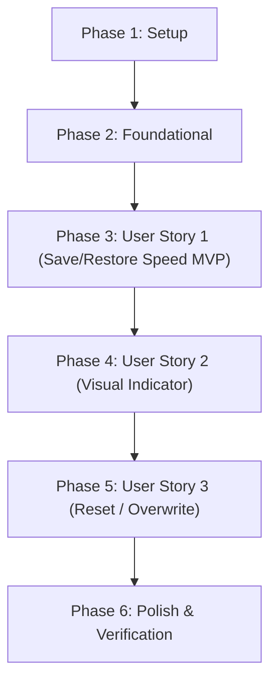

# Tasks: Per-PDF Auto-Scroll Speed Persistence

**Input**: Design documents from `/specs/003-per-pdf-scroll-speed/`  
**Prerequisites**: `plan.md`, `spec.md`, `research.md`, `data-model.md`, `contracts/speed-contracts.md`, `quickstart.md`, `.specify/memory/constitution.md`  
**Tests**: TDD approach is mandatory per Constitution Principle III. Unit tests for storage and ViewModel must be implemented and verified before implementation code.  
**Organization**: Tasks are grouped by user story to enable independent implementation, testing, and MVP delivery.  

## Format: `[ID] [P?] [Story] Description`

- **[P]**: Can run in parallel (different files, no dependencies on incomplete tasks)
- **[Story]**: Which user story this task belongs to (`[US1]`, `[US2]`, `[US3]`)
- Exact file paths are provided for all tasks

---

## Phase 1: Setup (Shared Infrastructure)

**Purpose**: Core model and storage contract baseline.

- [X] T001 [P] Update domain model `ReadingSession.kt` adding `customDefaultSpeedPxPerSec: Float? = null` with range validation in `app/src/main/java/com/madruga665/pdfreader/core/model/ReadingSession.kt`
- [X] T002 [P] Update storage interface `ReadingSessionStore.kt` adding `getCustomDocumentSpeed`, `saveCustomDocumentSpeed`, and `clearCustomDocumentSpeed` in `app/src/main/java/com/madruga665/pdfreader/core/storage/ReadingSessionStore.kt`

---

## Phase 2: Foundational (Blocking Prerequisites)

**Purpose**: MVI contracts and view state definitions required across all user stories.

**⚠️ CRITICAL**: No user story work can begin until this phase is complete.

- [X] T003 [P] Add `documentSavedSpeedPxPerSec: Float? = null` to `ReaderViewState.kt`, `SaveCurrentSpeedAsDocumentDefault` and `ResetDocumentSpeedToDefault` to `ReaderIntent.kt`, and `SpeedSavedForDocument` to `ReaderSideEffect.kt` in `app/src/main/java/com/madruga665/pdfreader/ui/reader/`

**Checkpoint**: Core domain contracts ready. User Story 1 implementation can now proceed.

---

## Phase 3: User Story 1 - Save and Restore Preferred Reading Speed per PDF (Priority: P1) 🎯 MVP

**Goal**: Persist a document's custom auto-scroll speed in DataStore, resolve it with highest priority upon opening that PDF, and allow the user to save the current speed as default.

**Independent Test**: Open Document A, set speed to 150 px/s, trigger save. Open Document B and observe standard default. Reopen Document A and verify auto-scroll initializes at 150 px/s.

### Tests for User Story 1 ⚠️

- [X] T004 [P] [US1] Unit test `DataStoreReadingSessionStoreTest.kt` verifying saving, loading, and clearing per-document custom default speed in `app/src/test/java/com/madruga665/pdfreader/core/storage/DataStoreReadingSessionStoreTest.kt`
- [X] T005 [P] [US1] Unit test `ReaderViewModelTest.kt` verifying speed precedence (custom speed > session speed > global default) and `ReaderIntent.SaveCurrentSpeedAsDocumentDefault` in `app/src/test/java/com/madruga665/pdfreader/ui/reader/ReaderViewModelTest.kt`

### Implementation for User Story 1

- [X] T006 [US1] Implement custom speed storage methods and session mapping in `DataStoreReadingSessionStore.kt` using key `custom_default_speed_<uri>` in `app/src/main/java/com/madruga665/pdfreader/core/storage/DataStoreReadingSessionStore.kt`
- [X] T007 [US1] Update `ReaderViewModel.kt` to resolve initial speed using `customDefaultSpeedPxPerSec`, handle `ReaderIntent.SaveCurrentSpeedAsDocumentDefault`, and emit `ReaderSideEffect.SpeedSavedForDocument` in `app/src/main/java/com/madruga665/pdfreader/ui/reader/ReaderViewModel.kt`

**Checkpoint**: User Story 1 is functional and testable independently as an MVP.

---

## Phase 4: User Story 2 - Clear Visual Indicator of Document's Saved Speed (Priority: P2)

**Goal**: Display an indicator within the speed controls showing the document's saved default speed (or general fallback), plus an explicit button to save the current speed for this PDF.

**Independent Test**: Open a PDF with a saved speed of 140 px/s, verify the badge displays "Padrão deste PDF: 140 px/s", adjust slider to 190 px/s and verify the badge continues to show the saved baseline until saved.

### Implementation for User Story 2

- [X] T008 [P] [US2] Update `SpeedSelectorControl.kt` to display a saved speed indicator/badge and a "Salvar como padrão deste PDF" action button in `app/src/main/java/com/madruga665/pdfreader/ui/components/SpeedSelectorControl.kt`
- [X] T009 [P] [US2] Update `FloatingAutoScrollOverlay.kt` and `AdaptiveReaderScaffold.kt` to pass `savedSpeedPxPerSec` and `onSaveCurrentSpeedAsDefault` callback to `SpeedSelectorControl` in `app/src/main/java/com/madruga665/pdfreader/ui/components/`

**Checkpoint**: User Stories 1 and 2 work together with clear visual status in the reader UI.

---

## Phase 5: User Story 3 - Update or Reset Document Speed to Global Default (Priority: P3)

**Goal**: Allow users to overwrite the custom speed or restore the document back to the global default speed.

**Independent Test**: On a document with custom speed, click "Restaurar padrão geral", verify custom speed is cleared and document returns to using the global default speed.

### Tests for User Story 3 ⚠️

- [X] T010 [P] [US3] Unit test `ReaderViewModelTest.kt` verifying `ReaderIntent.ResetDocumentSpeedToDefault` removes custom speed and reverts viewState in `app/src/test/java/com/madruga665/pdfreader/ui/reader/ReaderViewModelTest.kt`

### Implementation for User Story 3

- [X] T011 [US3] Add "Restaurar padrão" reset action in `SpeedSelectorControl.kt` when `savedSpeedPxPerSec != null`, and handle `ReaderIntent.ResetDocumentSpeedToDefault` in `ReaderViewModel.kt` in `app/src/main/java/com/madruga665/pdfreader/`

**Checkpoint**: Complete speed lifecycle management functional across all scenarios.

---

## Phase 6: Polish & Verification

**Purpose**: Automated test suite validation, build verification, and device installation.

- [X] T012 Run `./gradlew testDebugUnitTest` and compile APK with `./gradlew assembleDebug`
- [X] T013 Deploy APK to connected Samsung Galaxy Tab S9 FE (`model: SM_X510`) via `adb install -r` and verify end-to-end functionality

---

## Dependencies & Execution Order

### Phase Dependencies

### Parallel Opportunities

- **Phase 1 Setup**: `T001` and `T002` can run in parallel.
- **Phase 3 US1**: Tests `T004` and `T005` can run in parallel.
- **Phase 4 US2**: UI components `T008` and `T009` can be developed in sequence with decoupled components.
- **Phase 5 US3**: Test `T010` before `T011`.
